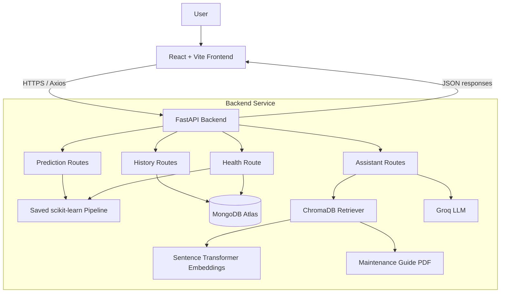
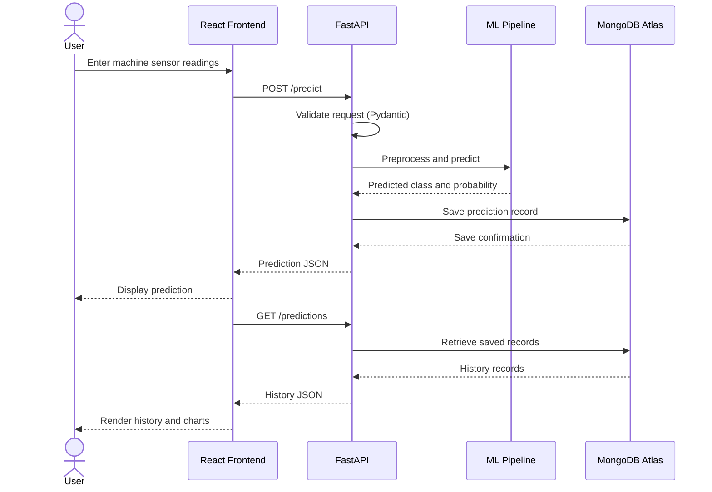
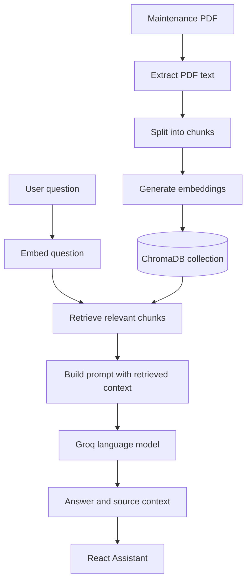
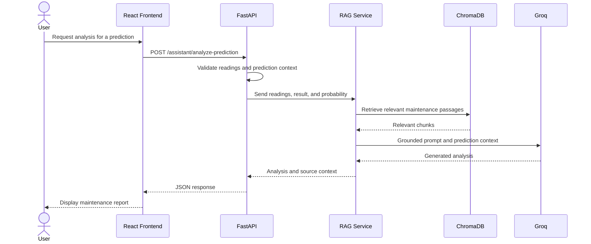
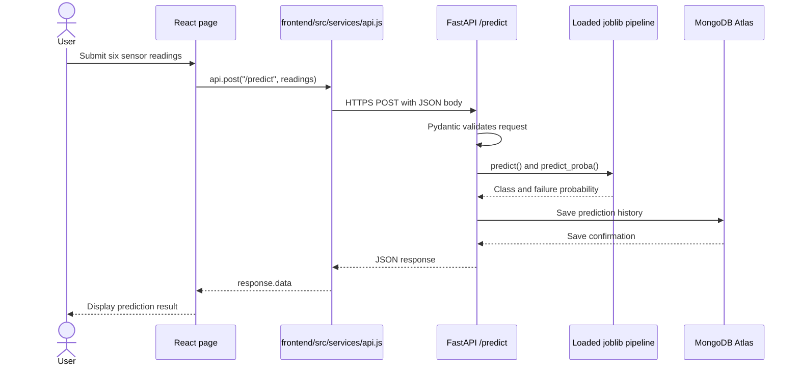

# MechMind AI — Predictive Maintenance & Intelligent Troubleshooting

<p align="center">
  <strong>Predict machine-failure risk, explore prediction history, and retrieve maintenance guidance.</strong>
</p>

<p align="center">
  <a href="https://mech-mind-ai.vercel.app/">Live Demo</a> ·
  <a href="https://mechmind-ai-backend.onrender.com/health">Backend Health</a> ·
  <a href="https://github.com/AnshMishra777/MechMind-Ai">GitHub Repository</a>
</p>

MechMind AI is a full-stack predictive-maintenance application. It combines a scikit-learn machine-learning pipeline, a FastAPI backend, MongoDB Atlas prediction history, and a Retrieval-Augmented Generation (RAG) maintenance assistant.

> **Safety note:** This is an academic and portfolio project. Its predictions are risk estimates, not confirmed diagnoses. Its maintenance guide is general educational material, not an OEM manual. Do not use the application as the sole basis for operating, shutting down, repairing, or maintaining industrial equipment.

---

## Contents

- [Overview and Features](#overview-and-features)
- [Live Application](#live-application)
- [Architecture](#architecture)
- [Workflows](#workflows)
- [Machine Learning](#machine-learning)
- [End-to-End ML Model Development and Integration](#end-to-end-ml-model-development-and-integration)
- [RAG Assistant](#rag-assistant)
- [Technology Stack](#technology-stack)
- [Repository Structure](#repository-structure)
- [API Reference](#api-reference)
- [Environment Variables](#environment-variables)
- [Local Setup](#local-setup)
- [Deployment](#deployment)
- [Evaluation](#evaluation)
- [Limitations and Future Work](#limitations-and-future-work)
- [Author](#author)

## Overview and Features

Unexpected equipment failures can lead to production downtime and increased maintenance costs. MechMind AI demonstrates a data-driven workflow that estimates machine-failure risk from operating-condition inputs.

A user supplies a machine type (`L`, `M`, or `H`), air temperature, process temperature, rotational speed, torque, and tool wear. The frontend sends these values to FastAPI. The backend validates the request, runs the saved preprocessing-and-classification pipeline, returns a predicted class and probability, and stores the result in MongoDB Atlas.

The application includes:

- **Fault prediction:** machine sensor form, model inference, predicted class, and failure probability.
- **Dashboard:** prediction summaries, failure-distribution and recent-probability charts.
- **Prediction history:** retrieve, refresh, and manage saved prediction records.
- **System health:** API, model, and database status checks.
- **RAG maintenance assistant:** retrieves relevant passages from a maintenance PDF and uses them as context for generated answers.
- **Prediction-aware analysis:** supplies sensor readings and prediction context to the assistant to generate a maintenance-oriented report.

## Live Application

| Component | URL |
|---|---|
| Frontend | https://mech-mind-ai.vercel.app/ |
| Backend health | https://mechmind-ai-backend.onrender.com/health |
| Interactive API docs | https://mechmind-ai-backend.onrender.com/docs |
| GitHub | https://github.com/AnshMishra777/MechMind-Ai |

The free Render service may spin down after inactivity, so its first request after an idle period can be slower due to a cold start.

## Architecture



| Component | Responsibility |
|---|---|
| React + Vite | Pages, forms, dashboard, charts, assistant interface |
| Axios | HTTP communication with FastAPI |
| FastAPI | Request validation, inference, history, health checks, RAG orchestration |
| scikit-learn | Preprocessing and failure classification |
| MongoDB Atlas | Persistent prediction history |
| ChromaDB | Vector storage and similarity retrieval over maintenance text |
| Sentence Transformers | Embedding model for document chunks and questions |
| Groq | Language-model response generation |
| Vercel | Frontend hosting |
| Render | Backend hosting |

## Workflows

### 1. Prediction and history



### 2. RAG document ingestion and question answering



### 3. Prediction-aware maintenance analysis



## Machine Learning

### Dataset

The project uses the **AI4I 2020 Predictive Maintenance Dataset** from the UCI Machine Learning Repository. It contains synthetic industrial operating data and failure labels. It is useful for demonstrating the workflow, but does not represent every real machine or operating environment.

### Input features

| Feature | Description |
|---|---|
| `Type` | Product type/category (`L`, `M`, or `H`) |
| `Air temperature [K]` | Air temperature |
| `Process temperature [K]` | Process temperature |
| `Rotational speed [rpm]` | Rotational speed |
| `Torque [Nm]` | Torque |
| `Tool wear [min]` | Tool wear in minutes |

The API maps the frontend sensor fields to the feature names expected by the trained pipeline.

### Preprocessing and estimator

The saved artifact is a scikit-learn `Pipeline` containing a `ColumnTransformer`, `OneHotEncoder` for the categorical feature, and a `RandomForestClassifier` configured with 200 estimators, balanced class weights, and a fixed random state. Keeping preprocessing and classification together helps ensure inference uses the same transformations as training.

Model artifact: `ml/artifacts/mechmind_model.joblib`.

## End-to-End ML Model Development and Integration

This section follows the complete path of the prediction feature: **dataset → model training → saved model file → FastAPI loading → prediction API → Axios service → React page**. Understanding this flow is useful when explaining the project in an interview.

### 1. Prepare the dataset and select features

The training data is the AI4I 2020 Predictive Maintenance Dataset at `ml/data/ai4i2020.csv`. The target is the machine-failure label (`Machine failure`). The model uses these six input columns:

```python
feature_columns = [
    "Type",
    "Air temperature [K]",
    "Process temperature [K]",
    "Rotational speed [rpm]",
    "Torque [Nm]",
    "Tool wear [min]",
]

X = df[feature_columns]
y = df["Machine failure"]
```

`X` contains the information the model learns from; `y` contains the correct class for each training example (`0` = no failure, `1` = failure). The dataset also contains other columns, but the model is trained using the six features above.

### 2. Split the data and build the preprocessing + ML pipeline

The categorical column `Type` must be encoded because a machine-learning estimator works with numerical input. The five sensor measurements are numeric and are passed through as numeric features. A `ColumnTransformer` applies the appropriate transformation, and a scikit-learn `Pipeline` joins preprocessing and the classifier into one object.

The following is a representative version of the training logic used for this project. Keep the feature names and preprocessing consistent with the actual training notebook/script when making changes:

```python
import pandas as pd
import joblib

from sklearn.model_selection import train_test_split
from sklearn.compose import ColumnTransformer
from sklearn.preprocessing import OneHotEncoder
from sklearn.pipeline import Pipeline
from sklearn.ensemble import RandomForestClassifier
from sklearn.metrics import (
    accuracy_score,
    classification_report,
    roc_auc_score,
)

# 1. Load the CSV dataset
df = pd.read_csv("ml/data/ai4i2020.csv")

# 2. Select model inputs and target
feature_columns = [
    "Type",
    "Air temperature [K]",
    "Process temperature [K]",
    "Rotational speed [rpm]",
    "Torque [Nm]",
    "Tool wear [min]",
]
X = df[feature_columns]
y = df["Machine failure"]

# 3. Split before fitting preprocessing to avoid data leakage
X_train, X_test, y_train, y_test = train_test_split(
    X,
    y,
    test_size=0.2,
    random_state=42,
    stratify=y,
)

# 4. Encode the categorical Type column
preprocessor = ColumnTransformer(
    transformers=[
        ("type", OneHotEncoder(handle_unknown="ignore"), ["Type"]),
    ],
    remainder="passthrough",
)

# 5. Create the classifier
classifier = RandomForestClassifier(
    n_estimators=200,
    class_weight="balanced",
    random_state=42,
    n_jobs=-1,
)

# 6. Keep preprocessing and model together
model = Pipeline(
    steps=[
        ("preprocessor", preprocessor),
        ("classifier", classifier),
    ]
)

# 7. Train
model.fit(X_train, y_train)

# 8. Evaluate on data not used for training
y_pred = model.predict(X_test)
y_probability = model.predict_proba(X_test)[:, 1]

print("Accuracy:", accuracy_score(y_test, y_pred))
print(classification_report(y_test, y_pred))
print("ROC-AUC:", roc_auc_score(y_test, y_probability))

# 9. Save the complete fitted pipeline
joblib.dump(model, "ml/artifacts/mechmind_model.joblib")
```

**Why Random Forest?** It is an ensemble algorithm that trains multiple decision trees and combines their predictions. It can model non-linear relationships between sensor measurements and failure labels. `n_estimators=200` means the forest contains 200 trees. `class_weight="balanced"` helps account for the fact that failure examples are much less common than non-failure examples in this dataset.

**Why save the whole pipeline?** The fitted `OneHotEncoder` and the classifier are saved together. At prediction time, the backend does not need to recreate or refit preprocessing; it simply passes the raw feature columns to the loaded pipeline.

### 3. Evaluate the trained model

Accuracy alone can be misleading for predictive maintenance because most rows in the dataset are non-failure examples. A model could achieve high accuracy while missing many actual failures. Therefore, also inspect precision, recall, F1-score, the confusion matrix, and ROC-AUC.

The project evaluation recorded these results on the held-out test set:

| Decision threshold | Failure precision | Failure recall | Failure F1 |
|---|---:|---:|---:|
| 0.50 (default class decision) | 0.71 | 0.66 | 0.69 |
| 0.30 (more sensitive threshold) | 0.51 | 0.84 | 0.64 |

At threshold `0.50`, the recorded confusion matrix was `[[1914, 18], [23, 45]]`. At threshold `0.30`, it was `[[1878, 54], [11, 57]]`.

These are the recorded precision/recall/F1 results; they are **not an accuracy or ROC-AUC value**. Calculate accuracy and ROC-AUC from the exact saved test split if you want to quote those metrics. Lowering the threshold catches more failures (higher recall), but also creates more false alarms (lower precision). The appropriate operating threshold depends on the cost of missed failures versus unnecessary inspections.

> **Dataset limitation:** AI4I 2020 is synthetic. These test results demonstrate the model's performance on that dataset's held-out split; they do not establish real-world industrial reliability.

### 4. Where the trained model is stored

After training, the complete fitted pipeline is exported as:

```text
ml/
└── artifacts/
    └── mechmind_model.joblib
```

`joblib.dump()` writes the trained object to disk. The `.joblib` file is a serialized Python/scikit-learn object, not a CSV dataset or source-code file. It should be generated by the training workflow and then made available to the backend at the same relative project path.

### 5. How FastAPI loads the saved model

The backend loads the model once when the API module starts. The project keeps the model artifact outside `backend/`, in the root-level `ml/artifacts/` directory. A robust path is built from the location of `main.py`, rather than relying on whichever folder the server command was launched from.

Representative loading code:

```python
from pathlib import Path
import joblib

# main.py is inside backend/api/
BASE_DIR = Path(__file__).resolve().parents[2]

MODEL_PATH = BASE_DIR / "ml" / "artifacts" / "mechmind_model.joblib"
model = joblib.load(MODEL_PATH)
```

Loading once avoids reading the model file for every request. The same fitted pipeline is then reused for incoming predictions.

### 6. How the prediction endpoint uses the model

FastAPI receives JSON from the frontend. A Pydantic request model validates the incoming values and types. The endpoint then creates a one-row pandas DataFrame with the exact feature names and order used during training.

The core inference pattern looks like this:

```python
import pandas as pd
from fastapi import FastAPI

app = FastAPI()

@app.post("/predict")
def predict(data: MachineData):
    # Convert validated API fields to the feature names used in training
    input_data = pd.DataFrame([{
        "Type": data.Type,
        "Air temperature [K]": data.air_temperature,
        "Process temperature [K]": data.process_temperature,
        "Rotational speed [rpm]": data.rotational_speed,
        "Torque [Nm]": data.torque,
        "Tool wear [min]": data.tool_wear,
    }])

    # Run the already-fitted preprocessing + Random Forest pipeline
    predicted_class = int(model.predict(input_data)[0])
    failure_probability = float(model.predict_proba(input_data)[0][1])

    # The actual application also records the prediction in MongoDB
    # and returns the prediction result to the frontend.
```

`predict()` returns the predicted class. `predict_proba()` returns class probabilities; index `[1]` is the probability for the failure class (`1`). Converting NumPy values to normal Python `int` and `float` makes them straightforward to serialize as JSON.

The actual endpoint also saves the prediction record using the MongoDB collection from `backend/database.py`. The model artifact and the prediction-history database are separate: the `.joblib` file stores the trained model, while MongoDB stores the results users have generated.

### 7. FastAPI routes exposed to the frontend

The backend exposes these main routes:

| Method | Endpoint | Purpose |
|---|---|---|
| `GET` | `/` | Basic API/root response |
| `GET` | `/health` | Reports API, model, and database health |
| `POST` | `/predict` | Validates readings, predicts failure risk, and stores the result |
| `GET` | `/predictions` | Retrieves saved prediction history |
| `POST` | `/assistant/ask` | Sends a general maintenance question to the RAG assistant |
| `POST` | `/assistant/analyze-prediction` | Generates maintenance analysis using sensor readings and prediction context |

The project also has prediction-management routes for deleting history records. Check the live [Swagger documentation](https://mechmind-ai-backend.onrender.com/docs) for the exact route paths and request/response schemas; Swagger is generated from the running FastAPI application, so it is the best source of truth.

### 8. How the frontend Axios API service connects to FastAPI

The frontend keeps HTTP configuration in one place: `frontend/src/services/api.js`. Axios is configured with the deployed backend URL from the Vite environment variable. During local development, it falls back to the local FastAPI address.

```javascript
import axios from "axios";

const api = axios.create({
  baseURL:
    import.meta.env.VITE_API_BASE_URL ||
    "http://127.0.0.1:8000",
  headers: {
    "Content-Type": "application/json",
  },
});

export default api;
```

For the deployed Vercel frontend, the environment variable is:

```env
VITE_API_BASE_URL=https://mechmind-ai-backend.onrender.com
```

Vite exposes variables prefixed with `VITE_` to frontend code. This URL is public configuration, not a secret. After changing a Vercel environment variable, redeploy the frontend so the new value is included in the build.

### 9. How a React page calls the API and displays the result

A React page imports the shared Axios instance and calls the relevant route in response to a user action. A simplified example of the prediction-page pattern is:

```jsx
import { useState } from "react";
import api from "../services/api";

function Predict() {
  const [result, setResult] = useState(null);
  const [loading, setLoading] = useState(false);
  const [error, setError] = useState("");

  async function handlePredict(sensorReadings) {
    setLoading(true);
    setError("");

    try {
      const response = await api.post("/predict", sensorReadings);
      setResult(response.data);
    } catch (err) {
      setError(
        err.response?.data?.detail || "Unable to get a prediction."
      );
    } finally {
      setLoading(false);
    }
  }

  // The page's form calls handlePredict with the collected readings.
  // Render result, loading state, and error state in the component UI.
}
```

This is an explanatory pattern, not a replacement for the complete page implementation. In the actual application, the Predict page collects the six sensor inputs, sends them to `/predict`, and renders the returned result. The Dashboard uses the history and health endpoints to display saved records, charts, and service status. The Assistant page calls the assistant endpoints and displays the generated answer and supporting source information.

### 10. Full request-response path at a glance



### Interview explanation (about 60–90 seconds)

> “I used the AI4I 2020 predictive-maintenance dataset and selected six operating-condition features: machine type, air temperature, process temperature, rotational speed, torque, and tool wear. I split the data into training and test sets, then built a scikit-learn Pipeline with a ColumnTransformer and OneHotEncoder for the categorical machine type, followed by a Random Forest classifier with 200 trees and balanced class weights. I evaluated it using class-wise precision, recall, F1-score, and a confusion matrix because failure examples are imbalanced. I saved the fitted pipeline with joblib in `ml/artifacts/mechmind_model.joblib`. FastAPI loads that artifact when the backend starts. The `/predict` endpoint validates incoming sensor values with Pydantic, creates a DataFrame with the same feature names used during training, runs `predict` and `predict_proba`, and saves the result in MongoDB Atlas. On the frontend, a shared Axios instance reads the backend URL from `VITE_API_BASE_URL`. The React Predict page calls the endpoint and displays the JSON response. So the complete flow is React → Axios → FastAPI → saved ML pipeline → MongoDB, and then the response travels back to React.”

## RAG Assistant

The assistant uses a document-grounded retrieval workflow:

1. Extract text from the maintenance PDF using `pypdf`.
2. Split the text into smaller chunks.
3. Generate embeddings using `sentence-transformers/all-MiniLM-L6-v2`.
4. Store embedded chunks in the ChromaDB collection `maintenance_documents`.
5. Embed a user's question and retrieve relevant chunks.
6. Pass retrieved context to the Groq language model to generate a response.

The reference document is `docs/maintenance/MechMind_AI_Predictive_Maintenance_Guide_Expanded.pdf`. The prediction-analysis endpoint also supplies sensor readings, predicted result, and failure probability as context.

The guide is general educational material, not machine-specific OEM documentation. Generated recommendations must be checked against manufacturer documentation, site safety procedures, and qualified maintenance personnel. Model output is not a physical fault diagnosis.

## Technology Stack

| Area | Technologies |
|---|---|
| Frontend | React, Vite, Tailwind CSS |
| HTTP client | Axios |
| Charts | Recharts |
| Backend | Python, FastAPI, Uvicorn |
| Validation | Pydantic |
| Machine learning | scikit-learn, NumPy, pandas, joblib |
| Database | MongoDB Atlas, PyMongo |
| RAG | LangChain components, ChromaDB |
| Embeddings | Sentence Transformers, Hugging Face |
| LLM | Groq |
| PDF processing | pypdf |
| Hosting | Vercel (frontend), Render (backend) |
| Version control | Git, GitHub |

## Repository Structure

```text
MechMind-Ai/
├── backend/
│   ├── api/
│   │   └── main.py
│   ├── genai/
│   │   ├── __init__.py
│   │   ├── ingest.py
│   │   ├── rag.py
│   │   └── chroma_db/                 # Generated; ignored by Git
│   ├── ml/                            # Backend-side ML module(s)
│   └── database.py                    # MongoDB connection and collection
├── docs/
│   └── maintenance/
│       └── MechMind_AI_Predictive_Maintenance_Guide_Expanded.pdf
├── frontend/
│   ├── src/
│   │   └── services/
│   │       └── api.js
│   ├── package.json
│   └── ...
├── ml/
│   ├── artifacts/
│   │   └── mechmind_model.joblib
│   ├── data/
│   │   └── ai4i2020.csv
│   └── notebooks/
├── .env.example
├── .gitignore
├── .python-version
├── requirements.txt
├── requirements-render.txt
├── runtime.txt                         # If retained in this repository
└── README.md
```

Generated ChromaDB files, `.env`, virtual environments, `node_modules`, build output, and Python cache files should remain excluded from version control.

## API Reference

Base URL: `https://mechmind-ai-backend.onrender.com`

| Method | Endpoint | Purpose |
|---|---|---|
| `GET` | `/` | Basic API/root response |
| `GET` | `/health` | Reports API, model, and database status |
| `POST` | `/predict` | Runs a prediction and saves the result |
| `GET` | `/predictions` | Retrieves prediction history |
| `POST` | `/assistant/ask` | Sends a question to the RAG assistant |
| `POST` | `/assistant/analyze-prediction` | Generates analysis with prediction context |

The backend also has prediction-history deletion operations. Use `/docs` for the exact deletion paths, request schemas, and response models rather than guessing route names.

Health-check example:

```http
GET /health
```

```json
{
  "status": "healthy",
  "api": "online",
  "model": "loaded",
  "database": "connected"
}
```

Interactive documentation: https://mechmind-ai-backend.onrender.com/docs

## Environment Variables

Never commit real credentials, API keys, database connection strings, or local `.env` files.

Create a root-level `.env` for local backend development. The following is a template; keep it synchronized with the variables actually read by the code:

```env
# MongoDB Atlas
MONGO_URI=mongodb+srv://<username>:<password>@<cluster>/<database>?retryWrites=true&w=majority

# Groq
GROQ_API_KEY=your_groq_api_key
GROQ_MODEL=openai/gpt-oss-20b

# Embeddings and vector store
EMBEDDING_MODEL=sentence-transformers/all-MiniLM-L6-v2
CHROMA_PATH=backend/genai/chroma_db

# Optional integrations, only if used by the current code
HUGGINGFACEHUB_ACCESS_TOKEN=your_huggingface_token
GOOGLE_API_KEY=your_google_api_key
```

### Frontend configuration

Vercel Production/Preview environment variable:

```env
VITE_API_BASE_URL=https://mechmind-ai-backend.onrender.com
```

For local frontend development, create `frontend/.env.local` if needed:

```env
VITE_API_BASE_URL=http://127.0.0.1:8000
```

Vite exposes variables prefixed with `VITE_` to browser code. Only put non-sensitive configuration such as the public API base URL in these variables. Never put API keys, database credentials, or other secrets in frontend variables.

| Variable | Used by | Purpose |
|---|---|---|
| `MONGO_URI` | Backend | MongoDB Atlas connection string |
| `GROQ_API_KEY` | Backend | Groq authentication |
| `GROQ_MODEL` | Backend | Groq model selection |
| `EMBEDDING_MODEL` | Backend | Sentence-transformer model name |
| `CHROMA_PATH` | Backend | ChromaDB persistence directory |
| `HUGGINGFACEHUB_ACCESS_TOKEN` | Backend, if required | Hugging Face access |
| `GOOGLE_API_KEY` | Backend, if required | Google API access |
| `VITE_API_BASE_URL` | Frontend | Backend API base URL |

Only configure optional integrations if the current code path uses them. Keep `.env.example` aligned with the actual `os.getenv` calls in the project.

## Local Setup

### Prerequisites

- Python 3.13.x recommended for the backend environment used for deployment.
- Node.js and npm.
- Git.
- MongoDB Atlas database or reachable MongoDB instance.
- Groq API key for assistant generation.

### 1. Clone the repository

```bash
git clone https://github.com/AnshMishra777/MechMind-Ai.git
cd MechMind-Ai
```

### 2. Create and activate a Python environment

Windows Command Prompt:

```cmd
python -m venv .venv
.venv\Scripts\activate
pip install -r requirements.txt
```

### 3. Configure backend variables

Create `.env` in the repository root using the template in [Environment Variables](#environment-variables). Add your own credentials locally; do not commit this file.

### 4. Build the RAG vector store

From the repository root:

```cmd
python -m backend.genai.ingest
```

This reads the maintenance PDF and creates the ChromaDB data at the configured `CHROMA_PATH`.

### 5. Start the backend

From the repository root:

```cmd
uvicorn backend.api.main:app --reload
```

API: `http://127.0.0.1:8000`  
Swagger UI: `http://127.0.0.1:8000/docs`

### 6. Install and start the frontend

Open a second terminal:

```cmd
cd frontend
npm install
```

Create `frontend/.env.local`:

```env
VITE_API_BASE_URL=http://127.0.0.1:8000
```

Start Vite:

```cmd
npm run dev
```

Open the local URL printed by Vite, normally `http://localhost:5173`.

### 7. Verify

- Open `/health` and check API, model, and database status.
- Submit sensor readings in Fault Prediction.
- Confirm a prediction is returned and appears in Prediction History.
- Ask a question in AI Assistant.
- Request an AI analysis for a prediction.

## Deployment

### Backend — Render

The backend is deployed as a Render Web Service.

Build command:

```bash
pip install -r requirements-render.txt && python -m backend.genai.ingest
```

Start command:

```bash
uvicorn backend.api.main:app --host 0.0.0.0 --port $PORT
```

Set backend secrets and configuration in Render's Environment settings. Configure CORS in FastAPI to allow the actual frontend production origin. Add only the preview origins you intend to support, and update the allowlist if the frontend domain changes.

### Frontend — Vercel

| Setting | Value |
|---|---|
| Root Directory | `frontend` |
| Framework Preset | Vite |
| Install Command | `npm install` |
| Build Command | `npm run build` |
| Output Directory | `dist` |

Set `VITE_API_BASE_URL` to the Render backend URL in Vercel. After changing environment variables, redeploy so the new value is included in the frontend build.

### Database — MongoDB Atlas

The backend connects to the `mechmind_ai` database and uses the `predictions` collection. Configure Atlas database credentials and network access securely. Never expose the MongoDB connection string in frontend code or public repositories.

### Free-tier considerations

- Render free services may spin down after inactivity, causing cold-start delays.
- Free hosting plans have resource and usage limits.
- A ChromaDB directory on an ephemeral hosting filesystem may not survive restarts or redeployments. The current build process recreates the vector store from the tracked PDF; persistent or managed vector storage would be more robust.
- Embedding-model downloads and loading can consume considerable build time and memory on a small instance.

## Evaluation

The following are the recorded held-out test-set results from the project's model experiments. They are not evidence of real-world industrial performance.

### Classification threshold: 0.50

| Metric (failure class) | Score |
|---|---:|
| Precision | 0.71 |
| Recall | 0.66 |
| F1-score | 0.69 |

```text
                 Predicted
                 No Failure  Failure
Actual No Failure    1914       18
Actual Failure         23       45
```

### Classification threshold: 0.30

| Metric (failure class) | Score |
|---|---:|
| Precision | 0.51 |
| Recall | 0.84 |
| F1-score | 0.64 |

```text
                 Predicted
                 No Failure  Failure
Actual No Failure    1878       54
Actual Failure         11       57
```

Lowering the threshold increased failure recall but also increased false positives. The operational threshold should be chosen using real-world validation data and the costs of missed failures versus false alarms.

**Dataset caveat:** AI4I 2020 is synthetic. These metrics do not establish safety or accuracy for real industrial equipment.

## Limitations and Future Work

### Current limitations

- The training data is synthetic and may not represent real machines, sites, or failure modes.
- A predicted probability is not a confirmed diagnosis.
- The maintenance PDF is general reference material, not an OEM-specific service manual.
- RAG quality depends on the coverage and quality of indexed documents.
- Free hosting introduces cold starts, resource constraints, and possible loss of locally persisted vector-store data.

### Potential improvements

- Validate and retrain with real, machine-specific sensor data.
- Add cross-validation, probability calibration, precision-recall analysis, and threshold selection based on operational costs.
- Add explainability (for example, SHAP feature contributions).
- Add authentication, role-based access, and audit trails.
- Add machine-level time-series monitoring, alerts, and trend analysis.
- Add automated backend/frontend tests and CI checks.
- Use persistent or managed vector storage and monitor retrieval quality.
- Monitor API latency and model performance.

## Author

**Ansh Ranjan Mishra**  
B.Tech — Engineering and Computational Mechanics, NIT Jamshedpur

- GitHub: https://github.com/AnshMishra777
- Project repository: https://github.com/AnshMishra777/MechMind-Ai
- Live application: https://mech-mind-ai.vercel.app/

---

*MechMind AI is an academic and portfolio project demonstrating machine learning, backend engineering, full-stack development, and retrieval-augmented generation. It is not certified industrial safety software.*
